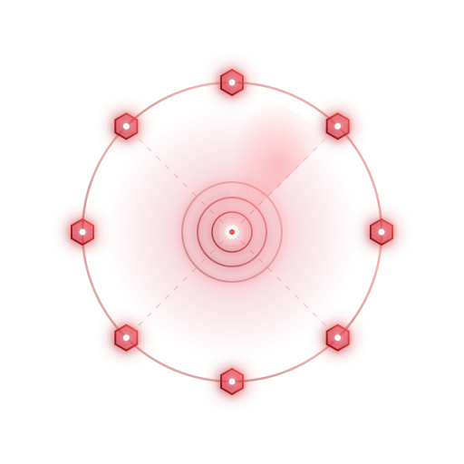

<p align="center">
  
  <h1 align="center">cyber-harness</h1>
  <p align="center">A general-purpose agent harness for cyber workflows — everything is an extension</p>
</p>

<p align="center">
  <a href="https://github.com/chainreactors/cyber-harness/releases"></a>
  <a href="https://github.com/chainreactors/cyber-harness/actions/workflows/ci.yml"></a>
  <a href="https://github.com/chainreactors/cyber-harness/releases"></a>
  <a href="https://github.com/chainreactors/cyber-harness/blob/master/LICENSE"></a>
  <a href="https://github.com/chainreactors/cyber-harness/stargazers"></a>
</p>

<p align="center">
  <a href="README_CN.md">中文文档</a>
</p>

---

cyber-harness is a general-purpose agent harness for cyber workflows. Model reasoning, tool execution, knowledge, observation, and collaboration are assembled through the same extension lifecycle. Tasks and installed extensions determine the tools and workflows to use. Use the reference distribution or compose the capabilities your own Go application needs.

Choose an entry point for your task:

| Entry point | Use it for |
| --- | --- |
| `aiscan` / `aiscan-full` | Agent tasks, scanners, proxy routing and IOA; the full edition adds Web, browser automation, passive recon and crawling |
| [`cyber-audit`](cmd/audit/README.md) | Model-led source-code and binary audits, evidence collection and reports |
| `cyber-web` (from source) | A profile-neutral Web Hub for sessions, events and artifacts from scan, audit or custom AOP nodes |
| `agent` | A minimal local Agent built from source, with files, terminal, Skills and local subagents |

> Use only on explicitly authorized targets.

## Start here

Download the archive matching your operating system and architecture from [GitHub Releases](https://github.com/chainreactors/cyber-harness/releases/latest). For CLI use, choose `aiscan` or `cyber-audit`, extract it and put the executable on PATH. Configure a model as described below before running an Agent task:

```sh
# With an LLM configured: run a local task and save its events
aiscan agent -p "Read the current directory and explain its structure; do not modify files" -o jsonl -f first-run.jsonl

# Audit a local repository
cyber-audit --workdir /path/to/repository -p "Audit authentication and tenant isolation"

# Run a deterministic scan against your own local lab, without AI verification
aiscan scan -i http://127.0.0.1:3000 --verify=off
```

For the Web workbench, download `aiscan-full` and start it:

```sh
aiscan-full web --token replace-me
```

Open `http://127.0.0.1:8080` and sign in with the access key. Quick Connect generates a one-line command that downloads and starts a scan or audit node on the execution host. To connect a node you already installed, run one of these commands in another terminal:

```sh
aiscan agent --server-url http://replace-me@127.0.0.1:8080
cyber-audit --workdir /path/to/repository --server-url http://replace-me@127.0.0.1:8080
```

See [Getting started (中文)](docs/getting-started.md) for installation, PowerShell configuration and a complete first run. The Agent lets the model choose tool calls; the scan pipeline chooses work through rules and scan events, with optional AI stages.

## Configure a model

Run `cyber-web init` or `aiscan init` to configure your model in `~/.cyber/cyber.yaml`. For project overrides, add `--project`. These are shared cyber-harness commands, also available in the minimal `agent` CLI. Existing files are preserved. [Configuration guide](docs/configuration.md).

Example `cyber.yaml`:

```yaml
llm:
  provider: openai
  base_url: https://api.deepseek.com/v1
  model: deepseek-chat
```

Set `CYBER_API_KEY` to your credential and use the endpoint and model available to your account. For Anthropic-compatible services, use `provider: anthropic` and the corresponding settings. See the [configuration reference](docs/reference.md) for protocols, profiles and precedence.

## Documentation

Start at the [documentation home](docs/README.md). The guides and references describe current behavior and are maintained primarily in Chinese. For a release, read the documentation at its Git tag.

| What you need | Guide |
| --- | --- |
| Understand the harness, models, tools and sessions | [Concepts](docs/concepts.md) |
| Install, configure and complete a first task | [Getting started](docs/getting-started.md) · [Model configuration](docs/configuration.md) |
| Use sessions, tools, Skills, scanning and collaboration | [User guide](docs/README.md#使用者指南) · [Audit guide](cmd/audit/README.md) |
| Build a Go application or embed a session | [Developer guide](docs/development.md) |
| Connect an external client or look up parameters | [Client integration](docs/integration.md) · [API](docs/api.md) · [Configuration and commands](docs/reference.md) |
| Understand lifecycle, execution and data ownership | [Architecture](docs/architecture.md) |
| Review changes before upgrading | [Changelog](docs/changelog.md) |

## Build and embed

### Prepare the source

Install Git and the Go version declared in [go.mod](go.mod) (currently Go 1.26). The Makefile requires GNU Make and a POSIX shell; on Windows, install an MSYS2 toolchain and put its tools on PATH, or use the direct PowerShell build below.

```sh
git clone --recurse-submodules https://github.com/chainreactors/cyber-harness.git
cd cyber-harness
# For an existing checkout
git submodule update --init --recursive
```

### Build a distribution

Run these commands from the repository root. Outputs go to `bin/`; Windows binaries have an `.exe` suffix.

| Command | Output | Capabilities | Frontend required |
| --- | --- | --- | --- |
| `make` / `make standard` | `bin/aiscan` | Agent, core scanners, proxy, Skills and IOA | No |
| `make full` / `make web-build` | `bin/aiscan-full` | Standard capabilities plus Web, browser, passive recon and crawling | Yes |
| `make audit` | `bin/cyber-audit` | Source-code and binary audit; built from the independent `cmd/audit` module | No |
| `make agent` | `bin/agent` | Local Agent, files, terminal, Skills and local subagents | No |
| `make all` | `bin/aiscan` and `bin/aiscan-full` | Standard and full editions | Yes |

For targets that require the frontend, install Node.js/npm (CI uses Node.js 22), then install dependencies once before building:

```sh
npm --prefix web/frontend ci
make
make full
```

These targets use `CGO_ENABLED=0`. `make web-build` builds the full edition; `make web` also starts its Web service. Build tags are maintained in [editions.env](editions.env), and the build steps in [Makefile](Makefile). To build the separate `cyber-web` Hub from source, run `make frontend`, then `CGO_ENABLED=0 go build -tags "full sqlite" -o bin/cyber-web ./cmd/cyber-web`. Native recording uses `make record`, requires CGO and its SDK, and has separate [build instructions](docs/record.md).

### Build the minimal local Agent

`make agent` needs only Go and the Makefile toolchain. It excludes scanner, proxy, IOA, browser, recording and Web dependencies. After [configuring a model](docs/configuration.md), run it directly with `-p`:

```sh
make agent
./bin/agent -p "Read the current directory and explain its structure; do not modify files"
```

To build without Make, use PowerShell from the repository root:

```powershell
$env:CGO_ENABLED = "0"
go build -trimpath -buildvcs=false -ldflags "-s -w" -o bin/agent.exe ./cmd/agent
.\bin\agent.exe -p "Read the current directory and explain its structure; do not modify files"
```

### Customize a minimal application

A minimal tool host, without a model. Save as `cmd/my-agent/main.go`:

```go
package main

import (
    "context"
    "fmt"
    "os"

    "github.com/chainreactors/cyber/agent/provider"
    "github.com/chainreactors/cyber/core/tool"
    "github.com/chainreactors/cyber/pkg/harness"
)

func main() {
    dir, err := os.Getwd()
    check(err)
    ctx := context.Background()
    app, err := harness.New(harness.Config{Base: harness.BaseConfig{
        Directory: dir,
        Provider: provider.StartupConfig{Mode: provider.StartupDisabled},
    }})
    check(err)
    defer func() { check(app.Close(ctx)) }()
    check(app.Load(ctx))

    bash, err := app.Bash()
    check(err)
    result, err := bash.Execute(ctx, `{"command":"echo Hello, Cyber!"}`)
    check(err)
    fmt.Println(tool.ResultText(result))
}

func check(err error) {
    if err != nil {
        panic(err)
    }
}
```

Build and run from the repository root:

```sh
CGO_ENABLED=0 go build -o bin/my-agent ./cmd/my-agent
./bin/my-agent
# Hello, Cyber!
```

PowerShell:

```powershell
$env:CGO_ENABLED = "0"
go build -o bin/my-agent.exe ./cmd/my-agent
.\bin\my-agent.exe
```

Extend it: [register tools](docs/developer/extensions.md) · [add a model and session](docs/developer/hosting.md#嵌入一个会话) · [retain the CLI](cmd/agent).

### Advanced builds

[Resource embedding switches](Makefile) · [External tools and offline distribution](docs/arsenal-bundles.md) · [Native recording](docs/record.md).

## Contributing

Read the [development guide](docs/development.md) and [documentation standards](docs/maintaining-docs.md). Test instructions are available for the [repository harness](cmd/harness/README.md), [Web frontend](web/frontend/e2e/README.md) and [audit](cmd/audit/tests/README.md). Describe the behavior change, affected entry points and validation in your PR. Update the relevant guide or reference with behavior changes.

## Disclaimer

1. This harness supports **authorized agent tasks and research in cyber workflows**. Run scanning examples in your own lab or another environment you are authorized to test.
2. Before using this tool for any scanning, you must ensure compliance with local laws and regulations and obtain **sufficient authorization. Do not scan unauthorized targets.**
3. If you engage in any illegal activity while using this tool, you shall bear all consequences yourself. We assume no legal or joint liability.
4. Before installing and using this tool, please **carefully read and fully understand all terms**. Limitation and disclaimer clauses may be highlighted for your attention.
5. Unless you have fully read, understood, and accepted all terms of this agreement, please do not install or use this tool. Your use or any other express or implied acceptance constitutes your agreement to be bound by these terms.

## License

This project is licensed under the [GNU Affero General Public License v3.0 (AGPL-3.0)](LICENSE).

## Links

- [chainreactors](https://github.com/chainreactors) — Organization
- [IOA](https://github.com/chainreactors/ioa) — Internet of Agents
- [sdk](https://github.com/chainreactors/sdk) — Scanner SDK
- [proxyclient](https://github.com/chainreactors/proxyclient) — Multi-protocol proxy client
- [crtm](https://github.com/chainreactors/crtm) — CLI tool package registry
- [utils](https://github.com/chainreactors/utils) — Shared utilities & PTY manager
- [parsers](https://github.com/chainreactors/parsers) — Protocol & data parsers

---

<p align="center">
  <a href="https://star-history.com/#chainreactors/cyber-harness&Date">
    
  </a>
</p>
